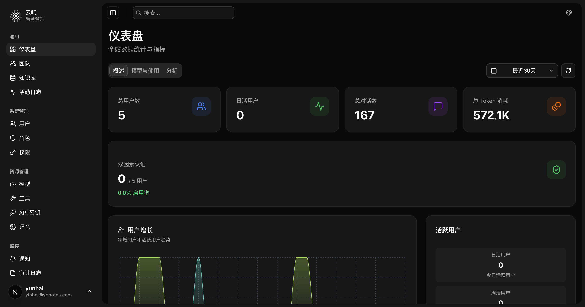

<p align="center">
  
</p>

# <p align="center">Clouisle</p>

<p align="center"><b>Next-Generation Multi-Agent Collaboration Platform and Workflow Engine</b></p>

<p align="center">
Build and orchestrate production-ready AI agent teams with sandboxed execution, hybrid RAG, and enterprise-grade security.
</p>

<p align="center">


<a href="https://github.com/clouisle/Clouisle/actions/workflows/ci.yml">
  
</a>
</p>

<p align="center">
<a href="https://clouisle.asia">Official Website</a> ·
<a href="docs/guide/README_zh-CN.md">简体中文</a> ·
<a href="#features">Features</a> ·
<a href="#quick-start">Quick Start</a> ·
<a href="#architecture">Architecture</a> ·
<a href="#documentation">Documentation</a>
</p>

---

## Table of Contents

- [Why Clouisle](#why-clouisle)
- [Features](#features)
- [Quick Start](#quick-start)
- [Architecture](#architecture)
- [Configuration](#configuration)
- [Use Cases](#use-cases)
- [Roadmap](#roadmap)
- [Documentation](#documentation)
- [Contributing](#contributing)
- [Contributors](#contributors)
- [License](#license)

---



---

## Why Clouisle?

Modern enterprises face a common challenge: **data fragmentation, low reusability, and zero intelligence execution**. Knowledge is scattered across documents, databases, wikis, and internal tools — but when decisions need to be made, that knowledge remains static and non-actionable.

**Clouisle transforms this reality** by providing:

- **Multi-Agent & Collaborative Runtime**: Build and orchestrate production-ready AI agent teams — workflows compose published agents through `agent` and `sub_workflow` nodes — with reasoning, sandboxed tool execution, human-in-the-loop interaction, and durable execution
- **Visual Workflow Orchestration**: Graph-based workflow builder with 19 node types, nested sub-workflows, human approval steps, and execution profiling
- **Intelligent Knowledge & Evaluation**: Hybrid search (vector + lexical) with reranking, multi-format parsing, and a retrieval lab for A/B comparison with per-stage diagnostics
- **Enterprise-Grade Security & Governance**: Multi-tenancy, granular RBAC, SSO (OIDC/OAuth2/SAML2/CAS, plus optional Feishu sign-in), TOTP 2FA, field-level audit diffs, and centralized observability
- **Production Portability**: Standardized `.clouisle` packages for safe multi-environment migration, 23 LLM providers, and sandboxed execution isolated in Bubblewrap user and mount namespaces

> Think of Clouisle as a **living intelligence layer** that evolves with your business.

---

## Features

### AI Agent & Multi-Agent Collaboration

- **Multi-Agent Orchestration**: Workflows invoke published agents through `agent` and `sub_workflow` nodes, composing them into multi-agent pipelines
- **Multi-Model Support**: Configure agents with different LLM providers, parameters, and thinking/reasoning modes
- **Human-in-the-Loop & Durable State**: Model-driven interactive inputs via durable `ask_user` tool with options, freeform answers, run-pause/resume lifecycle, and explicit skip
- **RAG Integration**: Multiple retrieval modes — `off` (disabled), `auto` (automatic retrieval), and `agentic` (Agent-driven tool retrieval) — with knowledge base binding
- **Streaming & Thinking**: Real-time streaming responses with reasoning/thinking content support
- **Conversation Management**: Multi-turn conversations with version branching, manual stop, token usage tracking, and long-term memory (an entity/relation graph with semantic search)
- **Media Generation**: Text-to-image and text-to-video generation within conversations (audio generation is available at the model/adapter level)
- **Tool System & Skills**: Built-in tools, custom HTTP/code/database tools, reusable Skill packages, and MCP protocol integration
- **Context Compression**: Automatic context summarization for long-running sessions — before each model call the request is estimated and, above 90% of the limit, a generated summary replaces older history while a recent verbatim tail is retained
- **Visibility Control**: Private or team visibility with RBAC enforcement (`public` remains a reserved enum value and is not selectable)

### Visual Workflow Builder

- **No-Code Interface**: Drag-and-drop workflow creation with real-time node configuration
- **19 Node Types**: LLM, Media Generation, Decision, Agent, Condition, Question Classifier, Code Execution (Python/JavaScript), Knowledge Retriever, File to URL, Tool, Sub-workflow, Iteration, Loop, Pause/Approval, Template, Variable Assignment, Variable Aggregation, Parameter Extractor, and Answer
- **Human-in-the-Loop Approval**: Pause nodes with configurable multi-strategy approval, form variables, and deep-link resumes
- **Execution Triggers**: Manual, webhook, or API. A Cron trigger can be stored on a workflow, but scheduled execution requires registering the scheduler task in the deployment — it does not run by default
- **Versioning**: Draft/publish lifecycle with version history and rollback
- **Real-Time Monitoring**: Streaming execution with live node-level status updates and trace timeline
- **Debug Mode**: Step-by-step testing with variable inspection before deployment
- **Sub-Workflows**: Nest and reuse workflows as sub-workflow nodes
- **Profiling & Metrics**: Execution profiling with per-node status, latency, and token usage

### Knowledge Base System

- **Multi-Format Support**: PDF, DOCX, XLSX, Markdown, and more via MarkItDown
- **Hybrid Search**: Vector similarity (Qdrant) + BM25 lexical search (pg_search) with Reciprocal Rank Fusion
- **Retrieval Lab**: Run a production retrieval query, compare two configurations side by side (A/B), and inspect recall, rerank, fusion and final ranking with per-stage diagnostics
- **Configurable Chunking**: Customizable chunk size, overlap, and separator with preview and failed-chunk retry
- **Reranking**: Optional reranking pipeline to improve retrieval accuracy
- **Embedding Management**: Configurable embedding models and vector dimensions
- **Async Document Processing**: Background processing via Celery with status tracking and batch operations
- **Lexical Search**: PostgreSQL-powered full-text search with Chinese segmentation (jieba)
- **Search Modes**: Vector-only, full-text only, or hybrid with configurable weight tuning
### LLM Provider Support

Every provider is configured from the admin console: you supply the API key, optional base URL, model ID, and capability markers. The platform registers 23 provider codes; which models are usable depends on what you configure and what the provider currently offers.

Supported capabilities by provider code:

| Capability | Provider codes |
|---|---|
| Chat / completion | `openai`, `anthropic`, `google`, `xai`, `azure_openai`, `deepseek`, `moonshot`, `zhipu`, `qwen`, `baichuan`, `minimax`, `volcengine`, `siliconflow`, `ollama`, `custom` |
| Embedding | `openai`, `openai_responses`, `azure_openai`, `google`, `deepseek`, `moonshot`, `zhipu`, `qwen`, `baichuan`, `minimax`, `volcengine`, `siliconflow`, `xai`, `ollama`, `custom` |
| Reranking | Chat providers through an LLM reranker, plus native OpenAI-compatible rerank APIs (including SiliconFlow) |
| Text-to-image | `openai`, `openai_responses`, `azure_openai`, `google`, `runway`, `luma`, `stability`, `volcengine`, `siliconflow`, `minimax`, `custom` |
| Text-to-video | `runway`, `luma`, `kling`, `pika`, `siliconflow`, `volcengine`, `minimax`, `qwen` |
| TTS | `openai`, `azure_openai`, `volcengine`, `minimax` |
| STT | `openai`, `azure_openai` |
| Audio generation | `volcengine` |
| Typed decisions | `typesafe` (`choice`, ordered `score`, or `noul` with probabilities and confidence) |

`custom` accepts any OpenAI-compatible endpoint for chat, embedding, and image generation. `midjourney` exists as a provider code for UI compatibility but has no built-in adapter; use a `custom` endpoint if you front it with your own proxy.

### Model Management

- **Multi-Provider**: Centralized model configuration across 23 providers with standardized interfaces
- **Model Registry**: Register and manage chat, embedding, rerank, decision, TTS, STT, audio generation, text-to-image, and text-to-video models
- **Team Authorization**: Granular per-team model access control with daily/monthly token and request quotas
- **Connection Testing**: Built-in model connectivity testing before deployment
- **Default Parameters**: Configurable per-model defaults (temperature, top_p, max_tokens, thinking, etc.)
- **Capability Markers**: Tag models with capabilities (vision, function calling, streaming, etc.)
- **Encrypted Credentials**: Secure API key storage with encryption at rest

### Enterprise Features

- **Multi-Tenancy**: Team-based resource isolation with granular model authorization and quota tracking
- **RBAC**: Role-based permission system with custom roles and permission presets
- **SSO**: OIDC, OAuth2, SAML 2.0, and CAS single sign-on, plus optional Feishu web sign-in on the Feishu integration
- **Two-Factor Authentication**: TOTP-based 2FA for enhanced account security
- **Audit Logging**: Comprehensive action tracking with before/after field-level diff snapshots and user attribution
- **Admin Observability**: Comprehensive dashboards tracking token consumption, latency, error rates, and system health
- **Clouisle Packages**: Standardized `.clouisle` packages for safe, secret-free export/import and cross-environment asset migration (Agents, Workflows, Tools, and KBs)
- **Notification System**: In-app notifications plus external delivery over email, generic Webhook, or Feishu
- **Messaging Integrations**: Optional Feishu and WeChat iLink channels for private Agent chat and knowledge collection, with per-user identity binding and an operator-facing delivery log
- **API Key Management**: Scoped API keys with expiration, usage tracking, and Agent/workflow bindings
- **Site Settings**: Configurable site-wide settings with localization support (en/zh), including integrations, storage, and background memory extraction
- **Password Policies**: Configurable expiration, history, and complexity requirements

### Tool System

- **Built-in Tools**: Time/date, datetime formatting, calculator, unit conversion, site-managed web search (Tavily/Bocha/DeepSeek or configured SearXNG), webpage fetch, RSS reader, file parsing (MarkItDown), image/video generation, artifacts, and sandboxed bash/read/write/edit
- **Custom Tools**: HTTP API tools with authentication (API key, Bearer, Basic) and variable mapping, sandboxed code tools, and read-only database tools for PostgreSQL, MySQL, Redis, and MongoDB
- **MCP Integration**: Model Context Protocol for standardized tool capabilities and resource access
- **Sandboxed Execution**: Secure, isolated Python/JavaScript execution with resource limits — a dedicated worker runs tasks inside Bubblewrap user and mount namespaces; workers need `CAP_SYS_ADMIN`, `CAP_SETFCAP`, `CAP_NET_ADMIN`, and an unconfined seccomp profile.
- **Tool Registry**: Centralized tool management with credential injection and lifecycle hooks
---

## Quick Start
### Prerequisites

- Docker and Docker Compose v2 for single-server deployment
- `kubectl` for Kubernetes deployment; Helm 3 only when using the Helm chart

> For development from source, see the [Development Guide](docs/guide/getting-started/development.md).

### 1. Run the Guided Installer

```bash
curl -fsSL https://raw.githubusercontent.com/clouisle/Clouisle/main/deploy/install.sh | bash
```

Choose Docker Compose for a single server, Helm for Kubernetes, or a generated single-file Kubernetes manifest. Docker mode interactively selects an installation directory, defaulting to `/opt/clouisle`. The manifest generator writes a separate secret-filled file for review and explicit `kubectl apply`; it does not modify the template or apply to a cluster.

### 2. Access the Application

- **Frontend**: http://localhost:3000
- **API Documentation**: http://localhost:8000/docs

> For local development setup (backend + frontend from source), see the [Development Guide](docs/guide/getting-started/development.md).

### Deploy on Sealos

[](https://sealos.io/products/app-store/clouisle)

The community-maintained template provisions PostgreSQL, Redis, Qdrant, and persistent uploads using either local storage or an optional private Sealos object-storage bucket. Register the first account to create the initial Super Admin. The sandbox worker stays disabled by default because it requires an `Unconfined` seccomp policy or an equivalent `Localhost` profile; enable it only in a compatible workspace.

---

## Architecture

```
┌─────────────────────────────────────────────────────────────────┐
│                         Frontend (Next.js 16)                    │
│  ┌──────────┐  ┌──────────┐  ┌──────────┐  ┌──────────────────┐ │
│  │ Dashboard│  │ Platform │  │   Chat   │  │  Auth (SSO/Login)│ │
│  └──────────┘  └──────────┘  └──────────┘  └──────────────────┘ │
└─────────────────────────────────────────────────────────────────┘
                                  │
                                  ▼
┌─────────────────────────────────────────────────────────────────┐
│                      Backend (FastAPI)                           │
│  ┌──────────┐  ┌──────────┐  ┌──────────┐  ┌──────────────────┐ │
│  │  Agents  │  │ Workflows│  │Knowledge │  │  Users & Teams   │ │
│  │  Engine  │  │  Engine  │  │  Bases   │  │    Management    │ │
│  └──────────┘  └──────────┘  └──────────┘  └──────────────────┘ │
│  ┌──────────┐  ┌──────────┐  ┌──────────┐  ┌──────────────────┐ │
│  │   LLM    │  │   Tool   │  │  Audit   │  │   Notification   │ │
│  │ Adapters │  │  System  │  │ Logging  │  │     Service      │ │
│  └──────────┘  └──────────┘  └──────────┘  └──────────────────┘ │
└─────────────────────────────────────────────────────────────────┘
                                  │
                    ┌─────────────┼─────────────┐
                    ▼             ▼             ▼
             ┌──────────┐  ┌──────────┐  ┌──────────┐
             │PostgreSQL│  │  Redis   │  │  Qdrant  │
             │   (DB)   │  │ (Cache)  │  │ (Vector) │
             └──────────┘  └──────────┘  └──────────┘
```

### Tech Stack

**Backend**
- Framework: FastAPI (Python 3.13)
- ORM: Tortoise ORM with AsyncPG
- Task Queue: Celery + Redis
- Vector DB: Qdrant
- LLM Framework: LangChain (LangGraph is a declared dependency but is not used at runtime)

**Frontend**
- Framework: Next.js 16 (App Router)
- Production runtime: Node.js 22 (Next.js standalone); Bun is used for dependency management and builds
- UI: shadcn/ui + Tailwind CSS
- Language: TypeScript

---

## Configuration

### Environment Variables

Key configuration options (see `.env.example` for full list):

| Variable | Description |
|----------|-------------|
| `DATABASE_URL` | PostgreSQL connection string (auto-built from individual vars if unset) |
| `POSTGRES_SERVER` / `POSTGRES_PORT` / `POSTGRES_USER` / `POSTGRES_PASSWORD` / `POSTGRES_DB` | PostgreSQL connection details |
| `REDIS_HOST` / `REDIS_PORT` / `REDIS_PASSWORD` | Redis connection |
| `QDRANT_URL` / `QDRANT_API_KEY` | Qdrant vector database |
| `SECRET_KEY` | JWT signing key |
| `VECTOR_BACKEND` | Vector DB backend (default: qdrant) |
| `API_BASE_URL` | Public API URL for the backend |
| `FRONTEND_URL` | Frontend URL for CORS and redirects |
| `NEXT_PUBLIC_API_URL` | API URL consumed by the frontend |
| `TAVILY_API_KEY` | Legacy one-time import into site-managed search; use admin UI for subsequent configuration |
| `SANDBOX_RUNTIME_ENABLED` | Enable sandboxed code execution |

### Site Settings

Configure via the admin dashboard:

- **General**: Site name, description, branding, theme colors
- **Security**: Password policies, session timeout, login limits, network allowlists and their independent switches
- **Registration**: Enable/disable, require approval, email verification
- **Integrations**: SSO identity providers, email, Webhook, Feishu, and WeChat iLink
- **Notifications**: Auto-notification rules and external channels (email, Webhook, Feishu)
- **Storage**: Local uploads or S3-compatible object storage
- **Memory**: Background memory extraction model, cooldown, and pending-turn threshold

---

## Documentation

- User and operator docs: [docs/guide/README.md](docs/guide/README.md)
- Developer and architecture docs: [docs/dev/README.md](docs/dev/README.md)

---

## Use Cases

| Use Case | Description |
|----------|-------------|
| **Enterprise Q&A** | Deploy AI agents grounded in your internal knowledge with hybrid search and reranking for accurate, context-aware answers across documents |
| **Workflow Automation** | Build no-code workflows combining LLM reasoning, API integrations, code execution, and branching logic |
| **Customer Support** | Create intelligent support agents with knowledge base access, conversation memory, and escalation workflows |
| **Content Generation** | Automate text, image, and video generation pipelines with AI agents and media generation nodes |
| **Data Analysis** | Connect agents to internal databases and APIs for natural-language data querying and reporting |
| **Compliance & Risk** | Automate document analysis for contracts, policies, and regulatory requirements with audit trails |
| **Engineering Productivity** | Accelerate onboarding with instant access to documentation and tribal knowledge via RAG agents |

---

## Roadmap

- [x] Multi-provider LLM support (23 providers)
- [x] Visual workflow builder with human-in-the-loop approval
- [x] Hybrid RAG knowledge base with a retrieval lab (A/B comparison and stage diagnostics)
- [x] Enterprise SSO (OIDC, SAML, CAS, OAuth2)
- [x] Multi-channel notifications
- [x] Field-level audit logging & diff snapshots
- [x] Admin observability & performance dashboard
- [x] Standardized `.clouisle` asset packages for cross-environment migration
- [x] Build and orchestrate AI agent teams — workflows compose published agents through `agent` and `sub_workflow` nodes
- [ ] Autonomous peer-to-peer agent collaboration (agents negotiating with each other outside workflow orchestration)
- [ ] Industry-specific agent templates
- [ ] Plugin & tool marketplace
- [ ] Mobile application
---

## Contributing

We welcome contributions! Please see our [Contributing Guide](CONTRIBUTING.md) for details.

For development setup and commands (lint, test, build), see the [Development Guide](docs/guide/getting-started/development.md).

## Contributors

Thanks to all the people who have contributed to Clouisle:

<a href="https://github.com/clouisle/Clouisle/graphs/contributors">
  
</a>


## License

Clouisle is open-sourced under the [GPL v3](LICENSE) license.

---

## Acknowledgments

Clouisle is built on the shoulders of many outstanding open-source projects — from FastAPI and LangChain on the backend to Next.js and shadcn/ui on the frontend, plus infrastructure pillars like PostgreSQL, Redis, and Qdrant.

See [ACKNOWLEDGMENTS.md](ACKNOWLEDGMENTS.md) for the full list.

---

## Star History

<a href="https://star-history.com/#clouisle/Clouisle&Date">
  <picture>
    <source media="(prefers-color-scheme: dark)" srcset="https://api.star-history.com/svg?repos=clouisle/Clouisle&type=Date&theme=dark" />
    
  </picture>
</a>

---

<p align="center">
<b>Star us on GitHub</b> to support the project<br>
PRs are welcome · Build the future of enterprise AI together
</p>
