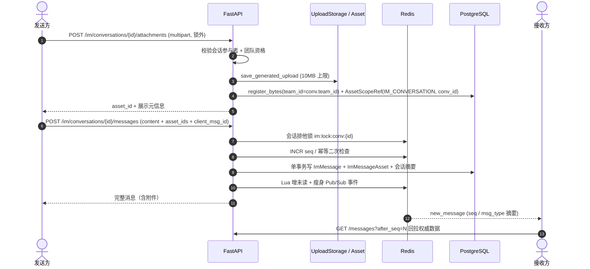

# 消息中心富媒体（图片 / 文件 / 图文混排）设计文档

## Background & Goals

### 1. 问题与现状

消息中心（`message-center-im`）目前只支持纯文本：`ImMessageType` 仅有 `text` / `markdown` / `card` / `system_notice`（`backend/app/models/im.py:19-23`），`ImMessage` 只有 `content: Text` 与 `payload: JSON`（`:133-137`）；`SendMessageRequest` 是纯 JSON（`backend/app/schemas/im.py:16-26`），前端输入区只有 `<Textarea>` 加发送按钮（`frontend/components/im/chat-window.tsx:551-583`），渲染侧除 `card` 审批卡片外统一 `<Streamdown>{msg.content}</Streamdown>`（`:496-531`）。

用户之间发送图片、文件、图文混排消息尚不支持。

### 2. 目标与成功指标

- 同一团队单聊内可发送图片、任意文件、文本 + 多附件混排；系统通知会话保持只读。
- **不破坏现有分布式并发契约**：seq 严格单调无空洞、发送幂等、未读数准确、跨节点 SSE 实时送达、游标分页性能不退化。
- 附件访问受 `team_id` 与会话参与者双重约束，杜绝凭 URL 跨团队读取。
- 全程可回滚：功能开关关闭后回退到纯文本，历史消息不受影响。

### 3. 非目标（本期不做）

已读回执、附件消息撤回/编辑联动、服务端缩略图与图片压缩、附件全文检索（`search_messages` 仍只搜 `content`）、音视频流式播放。这些都会引入新的并发面，留待后续独立设计。

---

## High-Level Design

### 1. 复用已有基础设施，不新建存储层

| 已有能力 | 位置 | 复用方式 |
| --- | --- | --- |
| 通用上传端点 | `backend/app/api/v1/endpoints/upload.py:316` (`/image`)、`:394` (`/file`) | **不能直接复用**（见风险 R6），但复用其 `save_generated_upload` 与 `asset_service.register_bytes` |
| `Asset` 模型（`team_id` / `created_by_id` / `status` / `checksum` / `storage_key`） | `backend/app/models/asset.py:40-88` | IM 附件统一登记为 Asset |
| `AssetScopeRef` 作用域绑定 | `backend/app/models/asset.py:121-142` | 新增 `AssetScopeType.IM_CONVERSATION`，把资产绑定到 IM 会话 |
| 受保护资产授权 | `backend/app/services/asset_access.py:246-292`（`authorize_protected_asset`）、`:189-235`（`authorize_asset_scope`） | 扩展 `IM_CONVERSATION` 分支 |
| 文件访问路由 | `backend/app/api/v1/endpoints/upload.py:554-568` | 依据 `AssetScopeRef` 判定 `is_protected` |
| `MessageAsset` 关联表范式 | `backend/app/models/asset.py:91-118`、迁移 `backend/app/core/init_data.py:1353-1359` | 照此新建 `ImMessageAsset`（不复用，因为外键指向不同的 `Message` 表） |

**关键结论**：通用 `/upload/image|file` 目前写 `team_id=None`（`upload.py:359`）且不创建 `AssetScopeRef`，因此文件访问路由判定 `is_protected=False`（`upload.py:564-568`），任何登录用户凭 URL 即可读取。IM 是 `team_id` 隔离的，直接复用会造成越权。必须新增 IM 专用上传端点。

### 2. 数据流

**设计要点**：字节 IO 全在锁外；锁内只有元数据校验与几次 DB 写入，会话锁租约保持 10s 不变。

---

## 分布式并发与一致性设计

### 1. 现有并发契约（必须保持的基线）

| 编号 | 契约 | 实现位置 |
| --- | --- | --- |
| C1 | 会话级排他锁串行化同会话写入 | `im_redis.py:65-109`，`im_service.py:240-241`（lease 10s，自旋 5s，Redis 异常**降级放行**） |
| C2 | Redis INCR 原子生成 seq，冷启动回查 DB 校准，Redis 故障降级 `MAX(seq)+1` | `im_redis.py:119-157` |
| C3 | `client_msg_id` 幂等：缓存 → DB 查询 → 锁内二次检查 → 结果缓存 TTL 60s | `im_service.py:225-248,298-308` |
| C4 | Lua 原子增减会话/全局未读数，支持由 DB 游标全量重建 | `im_redis.py:220-315` |
| C5 | Redis Pub/Sub `im:channel:user:{id}` 跨节点广播 `new_message` | `im_service.py:284-296`、`im_redis.py:318-332` |
| C6 | 创建会话分布式锁防重复会话 | `im_redis.py:112-116` |

### 2. 富媒体引入的新增风险与对策

| 编号 | 风险 | 后果 | 对策 |
| --- | --- | --- | --- |
| **R1** | 上传与发消息是两个独立请求，天然非原子 | 上传成功但发送失败/重试 → 孤儿资产；并发重试同一 `client_msg_id` 携带不同附件集合 → 幂等返回首条，其余资产成孤儿；消息落库但关联写入失败 → 消息无附件 | 上传时即写 `AssetScopeRef` 绑定会话；发送时只接受已绑定该会话且属于 `conv.team_id` 的 asset_id；**消息与关联在同一事务内写入**（见 R5）；孤儿资产由 TTL 回收任务处理，不阻塞主链路 |
| **R2** | 在会话锁内做文件字节 IO | 10MB 上传拉长持锁时间 → 锁租约 10s 到期被其他节点抢占 → C1/C2 被破坏，seq 乱序/空洞 | 上传必须走独立端点、发生在锁外；发送阶段只做 UUID 引用与元数据校验，锁内无网络/磁盘 IO，租约不变 |
| **R3** | 幂等键未覆盖附件集合 | 客户端重试时用户已增删图片，服务端静默返回首次结果，用户以为发了 3 张实际只有 2 张 | 定义「同 `client_msg_id` = 同一次提交」；前端在上传阶段固定附件列表并生成 `client_msg_id`，重试不得改变集合；服务端存附件 ID 摘要，不一致时明确拒绝而非静默吞掉 |
| **R3b** | `client_msg_id` 仅有 index、无 DB 唯一约束 | 依赖 Redis 锁 + DB 查询；C1 在 Redis 异常时 `return True` 降级放行，多节点同时降级可产生重复消息与重复资产引用 | 给 `ImMessage.client_msg_id` 加条件唯一约束或 upsert 作为最后防线；Redis 降级时发送失败必须返回明确错误码，让客户端保留草稿重传，不得 200 静默 |
| **R4** | 「DB 写消息 → Lua 增未读 → Pub/Sub 广播」三步非事务 | 进程崩溃时消息已落库但接收方未收到实时事件、未读数少增；富媒体消息体更大，Pub/Sub payload 放大问题 | 沿用 C4 的 `rebuild_unread_cache` 兜底；SSE 事件**瘦身为 `seq` / `conversation_id` / `msg_type`**，客户端收到后用 `GET /messages?after_seq=` 回拉权威数据；附件元数据只从 DB 取，不依赖事件体完整性 |
| **R5** | 关联写入放在锁外 | 并发下 B 消息先于 A 的附件可见，客户端按 seq 拉取时出现「消息存在但附件还没关联」的瞬态 | 锁内单事务（`in_transaction()`）顺序：`generate_next_seq` → `ImMessage.create` → `ImMessageAsset.bulk_create` → 会话摘要 → 提交；广播与未读递增在事务提交后 |
| **R6** | 资产权限与 IM team 边界不一致 | 通用上传端点产出 `team_id=None`、无 `AssetScopeRef`，文件路由视为公开；IM 是 team 隔离 | 新增 IM 专用上传端点：校验调用者是会话参与者 → 写 `Asset.team_id = conv.team_id` → 建 `AssetScopeRef(IM_CONVERSATION, conv_id)` → 扩展 `authorize_asset_scope` 加 `IM_CONVERSATION` 分支校验参与者与 team |
| **R6b** | 上传与发送之间用户被移出团队 | 上传时合法、发送时已无权，消息仍带附件落库 | 发送时**重新校验**当前团队资格（不能只信上传时）；每个 asset_id 二次校验 scope 绑定与当前会话一致，防止引用其他会话/团队的资产 |
| **R7** | 孤儿回收任务与用户发送并发 | 刚上传、尚未发消息的资产被清理任务删除 | 回收条件为 `created_at < now - TTL`（建议 24h，远大于上传→发送正常间隔）且无 `ImMessageAsset` 引用；用 `DELETE ... WHERE NOT EXISTS` 在 DB 层原子判定，或复用会话锁 |
| **R8** | 前端并发上传与会话切换竞态 | 多图进度乱序；粘贴图片与 Enter 发送竞态；上传回调写入错误会话 | 上传队列绑定 `convId` 快照，回调比对 `currentConvIdRef.current === convId` 才写入；上传中禁用发送；`client_msg_id` 在提交时生成并固定附件集合 |
| **R9** | 游标分页响应体积膨胀 | 一次最多 100 条（`im.py:98`），附件元数据与图片 URL 使响应变大；若 URL 需签名还涉及过期与并发刷新 | 消息体只存 `asset_id` + 展示元信息（文件名/大小/content_type/position），实际字节通过受保护文件路由按需请求；绝不把 base64 塞进 `content`、`payload` 或 Pub/Sub |
| **R10** | `content` 必填约束与纯附件消息冲突 | `SendMessageRequest.content` 有 `min_length=1`（`schemas/im.py:17-19`），纯图片/文件消息会被 422 拒绝 | `content` 放宽为可空字符串，service 层校验「`content` 与 `attachments` 至少一非空」；`_strip_markdown_summary`（`im_service.py:266`）对空正文生成 `[图片]` / `[文件]` 占位摘要 |

### 3. 并发验证口径

- 同一会话多 API 节点并发发送（含附件）后，`seq` 必须严格连续无空洞、无重复消息、无重复资产引用。
- 上传与发送并发时，会话锁持锁时间不因文件大小上升（对比纯文本基线）。
- 崩溃注入（消息落库后、广播前异常）：接收方断线重连按 `after_seq` 能补到**附件完整**的消息，未读数可由 DB 游标重建对齐。
- Redis 不可用：明确失败，不静默产生重复消息或孤儿资产。

---

## Implementation Plan

### Stage 1: 数据模型与向后兼容迁移

- **Files modified**: `backend/app/models/im.py`、`backend/app/models/asset.py`、`backend/app/models/__init__.py`、`backend/app/core/init_data.py`
- **Specific logic**:
  - `ImMessageType` 增加 `IMAGE`、`FILE`、`MIXED`；`ImMessage` 增加 `client_msg_id` 条件唯一约束（R3b）。
  - 新增 `ImMessageAsset`（`im_message_id`、`asset_id`、`position`、`role`），`unique_together (message, asset)`，照 `MessageAsset` 范式。
  - `AssetScopeType` 增加 `IM_CONVERSATION`。
  - 迁移沿用 `init_data.py` 的幂等 `CREATE TABLE IF NOT EXISTS` 风格；旧消息 `msg_type` 不变，无需回填。
- **Validation**: 在现有 DB 上重复执行启动迁移不报错；查询历史文本消息渲染不变；`uv run pytest` 模型相关测试通过。

### Stage 2: IM 专用上传端点与资产授权

- **Files modified**: `backend/app/api/v1/endpoints/im.py`、`backend/app/schemas/im.py`、`backend/app/services/asset_access.py`、`backend/app/api/v1/endpoints/upload.py`（仅复用 helper，不改通用端点行为）
- **Specific logic**:
  - `POST /im/conversations/{id}/attachments`：multipart，校验会话存在/类型为 `direct`/调用者为参与者/团队资格，沿用 `save_generated_upload` + `register_bytes(team_id=conv.team_id)`，写入 `AssetScopeRef(IM_CONVERSATION, conv_id)`，返回 `asset_id` 与展示元信息。10MB 与图片白名单沿用 `upload.py` 常量。
  - `authorize_asset_scope` 增加 `IM_CONVERSATION` 分支：查 `ImConversation`、校验参与者、`expected_team_id` 比对。
  - 文件访问路由保持现有 `is_protected` 判定逻辑，因新资产已有 scope ref 而自动进入受保护路径。
- **Validation**: 跨团队用户请求附件 URL 返回 404/403；会话外用户返回 403；同会话双方均可读；上传不写 `team_id=None`。

### Stage 3: 发送链路（锁内事务、幂等、事件瘦身）

- **Files modified**: `backend/app/services/im_service.py`、`backend/app/services/im_redis.py`、`backend/app/api/v1/endpoints/im.py`、`backend/app/schemas/im.py`
- **Specific logic**:
  - `SendMessageRequest` 增加 `asset_ids: list[UUID]`（上限，如 9），`content` 放宽为可空；service 校验「正文或附件至少一非空」（R10）。
  - `send_direct_message` 在会话锁内、单事务中：二次幂等检查 → 校验每个 asset 的 `team_id` 与 `AssetScopeRef` 绑定（R6b）→ `generate_next_seq` → 写 `ImMessage` + `ImMessageAsset` + 会话摘要（R5）→ 提交 → Lua 增未读 → 发**瘦身** SSE 事件（R4）。
  - 幂等结果缓存附带附件 ID 摘要，重试集合不一致时显式报错（R3）。
  - 摘要：`_strip_markdown_summary` 对空正文返回 `[图片]` / `[文件]` 占位（R10）。
  - 失败路径明确抛错，不静默返回成功（R3b）。
- **Validation**: 并发压测见「Testing Strategy」；纯文本消息行为与改动前一致（回归）；`seq` 连续无空洞。

### Stage 4: 读取契约与前端渲染

- **Files modified**: `frontend/lib/api/im.ts`、`frontend/components/im/chat-window.tsx`、`frontend/components/im/conversation-list.tsx`、`frontend/i18n/{en,zh}/notifications.json`、`frontend/i18n/types/notifications.ts`
- **Specific logic**:
  - `ImMessageOut` 增加 `attachments`（asset_id、filename、size、content_type、position）；`GET /messages` 用 `prefetch_related` 一次取出，避免 N+1。
  - 新增 `imApi.uploadAttachment`（FormData）与队列：绑定 `convId` 快照、并发上传、进度、失败重试（R8）。
  - 图片气泡走受保护文件路由按需加载；文件气泡提供下载；图文混排在正文下方按 `position` 渲染附件网格。
  - SSE `new_message` 收到后按 `after_seq` 回拉权威数据，不直接用事件体渲染附件（R4）。
  - 会话列表摘要展示 `[图片]` / `[文件]` 占位，`stripMarkdown` 不破坏占位符。
  - 中英 i18n 键同步（上传中、失败重试、大小超限、类型不支持）。
- **Validation**: `bunx tsc --noEmit`、`bunx eslint`、`bun run i18n:lint`；组件测试覆盖图文混排、上传中禁用发送、切换会话时丢弃过期回调。

### Stage 5: 孤儿资产回收与并发回归

- **Files modified**: `backend/app/tasks/`（新增回收任务或复用现有定时任务）、`backend/tests/services/test_im_*.py`、`backend/tests/api/test_im_endpoints.py`
- **Specific logic**: 回收条件与原子判定（R7）；并发压测脚本/用例；崩溃注入用例；跨团队越权用例。
- **Validation**: `uv run pytest` 全绿；覆盖率门槛（行/分支 ≥95%）保持；并发场景下 seq 与未读数断言。

### Stage 6: 文档、开关与交付验证

- **Files modified**: `docs/plan/im-rich-media.md`、`docs/IMPLEMENTATION_PLAN.md`、`docs/guide/`（消息中心使用说明）、`backend/app/core/config.py`（功能开关）
- **Specific logic**: 增加 `IM_RICH_MEDIA_ENABLED` 开关，关闭时上传端点返回 404、发送端点拒绝带附件的请求，回退纯文本；文档同步中英。
- **Validation**: 开关关闭后现有纯文本 IM 全链路回归通过；`git diff --check`；pre-push 门禁（ruff / eslint / pytest / bun test / tsc / i18n-lint / coverage）。

---

## Testing Strategy

### Happy path

- 单图、单文件、文本 + 多附件混排、纯附件（无正文）、图片与文件混合；系统通知会话保持只读。
- 双方在不同 API 节点上同时在线，附件实时送达且渲染完整。
- 断线重连按 `after_seq` 补拉，附件与未读数一致。

### Error path / 并发负向

- 同一会话多节点并发发送（含附件）→ seq 连续、无重复消息/资产引用。
- 同 `client_msg_id` 重试但附件集合不同 → 显式拒绝，不静默吞掉。
- Redis 不可用（锁降级 / seq 降级）→ 明确失败，无重复消息与孤儿资产。
- 上传成功但发送失败、消息落库后广播前崩溃 → 回收任务清理孤儿、重连补拉一致。
- 跨团队 asset_id 引用、被移出团队后发送、无 scope 的公开 URL 访问 → 全部拒绝。
- 超 10MB、非法 content_type、附件数量超限、上传中按 Enter、会话切换中的过期回调。

### Regression scope

纯文本 IM 收发、系统通知桥接与审批卡片（`im_system_bridge.py`）、未读红点与标记已读、SSE 多端已读同步、游标分页与 `around_seq` 搜索定位、会话列表摘要、全局未读数、i18n 中英键、现有 95% 覆盖率门禁。

---

## Risks & Mitigation

| 风险 | 影响 | 缓解 / 回滚 |
| --- | --- | --- |
| 破坏 C1/C2 并发契约 | seq 乱序、消息丢失 | 字节 IO 严格在锁外；锁内单事务；并发压测作为准入门槛 |
| 资产越权读取 | 跨团队数据泄露 | 专用上传端点 + `team_id` + `AssetScopeRef` + 发送时二次校验；安全回归用例 |
| 孤儿资产堆积 | 存储膨胀 | 24h TTL 回收 + DB 原子判定；监控未引用资产数量 |
| 通用 `/upload/*` 行为被误改 | 影响知识库、头像、沙箱产物等既有调用方 | 不改通用端点，仅复用其底层 helper（Stage 2） |
| 锁降级静默失败（既有行为） | Redis 故障时一致性缺口 | 本次不修改基线（`im_redis.py:88-90`），但发送链路显式失败；是否收紧降级策略另立变更评估 |
| 回滚 | 新功能需快速下线 | `IM_RICH_MEDIA_ENABLED=false` 即时回退纯文本；表与数据保留不删，避免历史附件消息损坏；先回滚前端，再按需保留后端表 |
