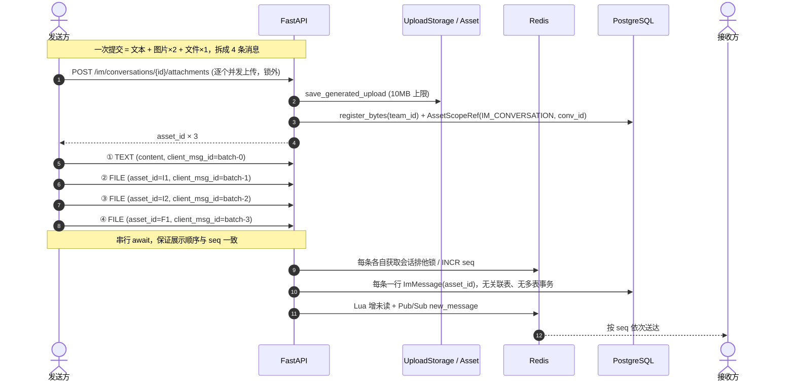

# 消息中心富媒体（图片 / 文件）设计文档

> 实现状态：Stage 1–5 已交付；Stage 6（功能开关、使用文档）待后续阶段。本文描述的是完整目标设计。

## Background & Goals

### 1. 问题与现状

消息中心（`message-center-im`）目前只支持纯文本：`ImMessageType` 仅有 `text` / `markdown` / `card` / `system_notice`（`backend/app/models/im.py:19-23`），`ImMessage` 只有 `content: Text` 与 `payload: JSON`（`:133-137`）；`SendMessageRequest` 是纯 JSON（`backend/app/schemas/im.py:16-26`），前端输入区只有 `<Textarea>` 加发送按钮（`frontend/components/im/chat-window.tsx:551-583`），渲染侧除 `card` 审批卡片外统一 `<Streamdown>{msg.content}</Streamdown>`（`:496-531`）。

用户之间发送图片、文件消息尚不支持；图文混排不在本期范围（改为拆分发送多条）。

### 2. 目标与成功指标

- 同一团队单聊内可发送图片、文件；纯文本消息保持不变。**不做图文混排**：一次提交同时含文本/图片/文件时，拆分为多条独立消息按序发送。系统通知会话保持只读。
- **不破坏现有分布式并发契约**：seq 严格单调无空洞、发送幂等、未读数准确、跨节点 SSE 实时送达、游标分页性能不退化。
- 附件访问受 `team_id` 与会话参与者双重约束，杜绝凭 URL 跨团队读取。
- 全程可回滚：功能开关关闭后回退到纯文本，历史消息不受影响。

### 3. 非目标（本期不做）

已读回执、附件消息撤回/编辑联动、服务端缩略图与图片压缩、附件全文检索（`search_messages` 仍只搜 `content`）、音视频流式播放、**图文混排 / 一条消息混合图片与文件 / 正文与附件交织排版**（按用户确认改为拆分发送多条）、跨多条消息的分布式事务。这些都会引入新的并发面，留待后续独立设计。

---

## High-Level Design

### 1. 复用已有基础设施，不新建存储层

| 已有能力 | 位置 | 复用方式 |
| --- | --- | --- |
| 通用上传端点 | `backend/app/api/v1/endpoints/upload.py:316` (`/image`)、`:394` (`/file`) | **不能直接复用**（见风险 R6），但复用其 `save_generated_upload` 与 `asset_service.register_bytes` |
| `Asset` 模型（`team_id` / `created_by_id` / `status` / `checksum` / `storage_key`） | `backend/app/models/asset.py:40-88` | IM 附件统一登记为 Asset |
| `AssetScopeRef` 作用域绑定 | `backend/app/models/asset.py:121-142` | 新增 `AssetScopeType.IM_CONVERSATION`，把资产绑定到 IM 会话 |
| 受保护资产授权 | `backend/app/services/asset_access.py:246-292`（`authorize_protected_asset`）、`:189-235`（`authorize_asset_scope`） | 扩展 `IM_CONVERSATION` 分支 |
| 文件访问路由 | `backend/app/api/v1/endpoints/upload.py:554-568` | 依据 `AssetScopeRef` 判定 `is_protected` |
| 单字段引用（替代关联表） | `backend/app/models/im.py:112-151` | 拆分发送后每条消息一个附件，`ImMessage.asset_id` 弱引用 Asset 即可，**无需 `ImMessageAsset` 表** |

**关键结论**：通用 `/upload/image|file` 目前写 `team_id=None`（`upload.py:359`）且不创建 `AssetScopeRef`，因此文件访问路由判定 `is_protected=False`（`upload.py:564-568`），任何登录用户凭 URL 即可读取。IM 是 `team_id` 隔离的，直接复用会造成越权。必须新增 IM 专用上传端点。

### 2. 数据流

**设计要点**：字节 IO 全在锁外；每条消息与附件引用在同一行落库，天然原子；会话锁租约保持 10s 不变。

### 3. 拆分发送语义（最终范围）

用户确认：图片 + 文件都要支持，但**不做图文混排**；当一次提交同时含有文件、图片和文本时，**拆分为多条消息发送**。

| 一次提交的内容 | 拆出的消息 |
| --- | --- |
| 文本 T | 1 条 `text`（`content=T`，`asset_id=null`） |
| 每张图片 Iₖ | 1 条 `file`（`content=""`，`asset_id=Iₖ`，`content_type=image/*`） |
| 每个文件 Fₖ | 1 条 `file`（`content=""`，`asset_id=Fₖ`） |

即每条消息恰好承载一个附件或一段纯文本，不存在 `mixed` 类型、不存在附件集合、不存在正文与附件交织排版。由此带来的简化：

- 删除 `ImMessageAsset` 关联表与 `MIXED` 消息类型；`ImMessage` 只增加可空的 `asset_id` 单字段。
- 「消息 + 附件引用」在同一行写入，R1（多表原子性）与原 R5（锁内多表事务）风险消失；锁内不再需要 `in_transaction()` 与 `bulk_create`。
- 幂等键天然覆盖唯一的 `asset_id`，不再需要附件集合摘要（R3 简化）。
- 前端不需要图文混排编辑器与 `position` 排序，只需图片/文件两个入口与上传队列。

**拆分发送引入的并发新风险见 R5 / R9 / R11 / R12。**

---

## 分布式并发与一致性设计

### 1. 现有并发契约（必须保持的基线）

| 编号 | 契约 | 实现位置 |
| --- | --- | --- |
| C1 | 会话级排他锁串行化同会话写入 | `im_redis.py:65-109`，`im_service.py:240-241`（lease 10s，自旋 5s，Redis 异常**降级放行**） |
| C2 | Redis INCR 原子生成 seq，冷启动回查 DB 校准，Redis 故障降级 `MAX(seq)+1` | `im_redis.py:119-157` |
| C3 | `client_msg_id` 幂等：缓存 → DB 查询 → 锁内二次检查 → 结果缓存 TTL 60s | `im_service.py:225-248,298-308` |
| C4 | Lua 原子增减会话/全局未读数，支持由 DB 游标全量重建 | `im_redis.py:220-315` |
| C5 | Redis Pub/Sub `im:channel:user:{id}` 跨节点广播 `new_message` | `im_service.py:284-296`、`im_redis.py:318-332` |
| C6 | 创建会话分布式锁防重复会话 | `im_redis.py:112-116` |

### 2. 富媒体引入的新增风险与对策

| 编号 | 风险 | 后果 | 对策 |
| --- | --- | --- | --- |
| **R1** | 上传与发消息是两个独立请求 | 上传成功但发送失败 → 孤儿资产 | 上传时即写 `AssetScopeRef` 绑定会话；孤儿由 TTL 回收任务处理，不阻塞主链路。消息与附件引用在同一行，无「消息已落库但附件未关联」的瞬态 |
| **R2** | 在会话锁内做文件字节 IO | 10MB 上传撑爆 10s 租约 → 其他节点抢锁 → C1/C2 破坏，seq 乱序/空洞 | 上传走独立端点、在锁外；发送阶段只做 UUID 引用与元数据校验，租约不变 |
| **R3** | `client_msg_id` 幂等未覆盖附件 | 重试时返回首次结果，附件被静默替换 | 每条消息只有一个 `asset_id`：同 `client_msg_id` 必须携带同一 `asset_id`，不一致时显式拒绝；前端重试不得更换附件 |
| **R3b** | `client_msg_id` 仅有 index、无 DB 唯一约束 | C1 在 Redis 异常时降级放行 → 多节点重复消息 | 锁内二次幂等检查 + 同 `client_msg_id` 不同 `asset_id` 显式拒绝 + 失败明确报错（客户端保留草稿重传）；DB 条件唯一索引不在启动迁移里创建（`execute_startup_migration_query` 有 2s 锁超时与 3s wait_for，大表建索引会超时），列为运维 runbook 可选项 |
| **R4** | 「DB 写消息 → Lua 增未读 → Pub/Sub 广播」三步非事务 | 崩溃时消息已落库但接收方未收到实时事件、未读数少增 | 沿用 C4 `rebuild_unread_cache` 兜底；SSE 事件保持现有结构，仅增加轻量 `attachment` 元信息（asset_id/文件名/大小/类型），绝不塞字节；断线重连用 `after_seq` 回拉权威数据 |
| **R5** | 一次提交拆成 N 条，若并发发出则顺序不确定 | 会话锁只保证 seq 单调，不保证请求到达顺序；并发 POST 会让图片/文件/文本展示顺序错乱 | **前端串行 `await`** 逐条发送（顺序：文本 → 图片按选择序 → 文件按选择序）；服务端不承诺跨请求顺序。N 条消息各自持有一次会话锁 |
| **R6** | 资产权限与 IM team 边界不一致 | 通用上传写 `team_id=None` 且无 `AssetScopeRef`，文件路由视为公开；IM 是 team 隔离 | IM 专用上传端点：校验参与者 → `Asset.team_id=conv.team_id` → `AssetScopeRef(IM_CONVERSATION, conv_id)` → `authorize_asset_scope` 加 `IM_CONVERSATION` 分支 |
| **R6b** | 上传与发送之间用户被移出团队 | 上传时合法、发送时已无权 | 发送时重新校验团队资格；逐条校验 `asset_id` 的 scope 绑定与当前会话一致 |
| **R7** | 孤儿回收任务与用户发送并发 | 刚上传、尚未发消息的资产被删 | `created_at < now - 24h` 且无消息引用；`DELETE ... WHERE NOT EXISTS` 原子判定 |
| **R8** | 前端并发上传与会话切换竞态 | 进度乱序、上传中按 Enter、回调写错会话 | 上传队列绑定 `convId` 快照，回调比对 `currentConvIdRef.current`；上传中禁用发送；`client_msg_id` 用 `${batchId}-${index}` 固定 |
| **R9** | 一次提交 N 个附件 → N 条消息 | N 次 seq 分配、N 次未读递增、N 次 SSE 广播；游标分页单页最多 100 条 | 每条消息只多一个轻量 `attachment` 对象；不存 base64；未读按游标计算，N 次递增不破坏正确性 |
| **R10** | `content` 必填与纯附件消息冲突 | `min_length=1` 会 422 拒绝图片/文件消息 | `content` 放宽为可空；service 校验「`text` 必须非空 content 且无 asset_id；`file`（统一附件类型，图片按 `content_type` 渲染）必须恰好一个 asset_id 且 content 为空」 |
| **R11** | 拆分发送的部分成功 | 第 k 条失败时前 k-1 条已送达；跨多条消息做分布式回滚不现实且与 seq 单调冲突 | 不做全量回滚：每条独立 `client_msg_id`，失败项可单独重试且天然幂等；UI 明确标注每条状态，保留未成功的草稿 |
| **R12** | 拆分发送时 SSE 事件乱序/重复 | 接收方按到达顺序渲染，可能与发送序不一致 | 事件带 `seq`；前端按 `seq` 插入并用 `client_msg_id` 去重（现有去重逻辑扩展）；断线按 `after_seq` 补拉 |

### 3. 并发验证口径

- 同一会话多 API 节点并发发送（含附件）后，`seq` 必须严格连续无空洞、无重复消息、无重复资产引用。
- 一次提交「文本 + 2 图 + 1 文件」拆成 4 条后，展示顺序与用户选择序一致，4 个 seq 连续。
- 拆分发送中途失败时，已成功的消息不回滚、失败项重试不重复。
- 上传与发送并发时，会话锁持锁时间不因文件大小上升（对比纯文本基线）。
- 崩溃注入（消息落库后、广播前异常）：接收方断线重连按 `after_seq` 能补到**附件完整**的消息，未读数可由 DB 游标重建对齐。
- Redis 不可用：明确失败，不静默产生重复消息或孤儿资产。

---

## Implementation Plan

### Stage 1: 数据模型与向后兼容迁移

- **Files modified**: `backend/app/models/im.py`、`backend/app/models/asset.py`、`backend/app/models/__init__.py`、`backend/app/core/init_data.py`、`backend/app/main.py`（挂载迁移）
- **Specific logic**:
  - `ImMessageType` 只增加 `FILE` 作为统一附件类型（**无 `IMAGE`、无 `MIXED`**）：图片与文档都是文件，渲染由 `Asset.content_type` 决定；一条消息只承载一个附件或一段文本。
  - `ImMessage` 增加 `asset_id: UUIDField(null=True)`（弱引用 `Asset`，避免跨表 FK 迁移复杂度）；**不在启动迁移里创建唯一索引**（见 R3b）。
  - `AssetScopeType` 增加 `IM_CONVERSATION`。
  - **不新建 `ImMessageAsset` 关联表**：拆分发送后消息与附件引用在同一行，天然原子。
  - 迁移：`init_data.py` 新增 `init_im_rich_media_columns()`，用 `execute_startup_migration_query` 执行 `ALTER TABLE im_messages ADD COLUMN IF NOT EXISTS asset_id UUID`，并挂到 lifespan 初始化链；沿用现有 `ADD COLUMN IF NOT EXISTS` 幂等模式（`asset_scope_refs.scope_type` 已是 `VARCHAR(20)`，可容纳 `im_conversation`，无需改列宽）。**不建索引**（见 R3b）。
  - 旧行 `asset_id` 为 NULL，`msg_type` 不变，无需回填；启动迁移把早期 `msg_type='image'` 的行归一为 `'file'`（幂等 `UPDATE`）。
- **Validation**: 在现有 DB 上重复执行启动迁移不报错；查询历史文本消息渲染不变；`uv run pytest` 模型相关测试通过。

### Stage 2: IM 专用上传端点与资产授权

- **Files modified**: `backend/app/api/v1/endpoints/im.py`、`backend/app/schemas/im.py`、`backend/app/services/asset_access.py`
- **Specific logic**:
  - `POST /im/conversations/{id}/attachments`：**一次一个文件**（multipart），校验会话存在/类型为 `direct`/调用者为参与者/团队资格，沿用 `save_generated_upload` + `register_bytes(team_id=conv.team_id)`，写入 `AssetScopeRef(IM_CONVERSATION, conv_id)`，返回 `asset_id` 与展示元信息。10MB 与图片白名单沿用 `upload.py` 常量。
  - `authorize_asset_scope` 增加 `IM_CONVERSATION` 分支：查 `ImConversation`、校验参与者、`expected_team_id` 比对。
  - 文件访问路由保持现有 `is_protected` 判定逻辑，因新资产已有 scope ref 而自动进入受保护路径；**不改通用 `/upload/*` 端点行为**。
- **Validation**: 跨团队用户请求附件 URL 返回 404/403；会话外用户返回 403；同会话双方均可读；上传不写 `team_id=None`。

### Stage 3: 发送链路（单行写入、幂等、事件元信息）

- **Files modified**: `backend/app/services/im_service.py`、`backend/app/api/v1/endpoints/im.py`、`backend/app/schemas/im.py`
- **Specific logic**:
  - `SendMessageRequest`：`content` 放宽为可空字符串，增加 `asset_id: UUID | None`；`msg_type` 只新增 `file`（图片不单独设类型）。
  - 两态校验（R10）：`text` 必须 `content` 非空且 `asset_id` 为空；`file` 必须 `content` 为空且恰好一个 `asset_id`；其余组合一律 400。
  - `send_direct_message` 在会话锁内：二次幂等检查（同 `client_msg_id` 但不同 `asset_id` → 显式拒绝，R3）→ 校验 `asset_id` 对应 `Asset.team_id == conv.team_id`、`status=AVAILABLE`、`AssetScopeRef(IM_CONVERSATION, conv_id)` 存在（R6b）→ `generate_next_seq` → **单行** `ImMessage.create(..., asset_id=...)` → 会话摘要 → Lua 增未读 → SSE 事件带轻量 `attachment`。**无 `in_transaction()`、无 `bulk_create`、无关联表**（拆分发送后 R1/R5 风险消失）。
  - `GET /messages` 与 SSE 事件按 `asset_id` 批量查 `Asset`（一次 `filter(id__in=...)`）组装 `attachment` 元信息，避免 N+1。
  - 摘要：附件消息按 `Asset.content_type` 生成占位：`image/*` → `[图片]`，其余 → `[文件]`；文本仍走 `_strip_markdown_summary`。
  - 失败路径明确抛错，不静默返回成功（R3b）。
- **Validation**: 纯文本消息行为与改动前一致（回归）；`seq` 连续无空洞；并发压测见「Testing Strategy」。

### Stage 4: 读取契约与前端渲染

- **Files modified**: `frontend/lib/api/im.ts`、`frontend/components/im/chat-window.tsx`、`frontend/components/im/conversation-list.tsx`、`frontend/i18n/{en,zh}/notifications.json`、`frontend/i18n/types/notifications.ts`
- **Specific logic**:
  - `ImMessageOut` 增加 `attachment`（asset_id、filename、size、content_type）；`GET /messages` 与 SSE 事件由后端批量查 Asset，避免 N+1。
  - 新增 `imApi.uploadAttachment`（FormData）与队列：绑定 `convId` 快照、并发上传、进度、失败重试（R8）；输入区增加「图片」「文件」两个入口。
  - **拆分发送**：一次提交的文本 + 附件列表转成消息数组（文本 1 条、每张图 1 条、每个文件 1 条），按固定顺序**串行 `await`** 逐条发送，`client_msg_id = ${batchId}-${index}`（R5 / R11）。上传中禁用发送。
  - 渲染：统一 `file` 消息按 `attachment.content_type` 分流——`image/*` 走受保护文件路由按需加载预览，其余显示文件卡片 + 下载入口；无图文混排编辑器、无 `position` 排序。
  - SSE `new_message` 按 `seq` 插入并用 `client_msg_id` 去重（R12）；断线按 `after_seq` 补拉权威数据。
  - 会话列表摘要展示 `[图片]` / `[文件]` 占位，`stripMarkdown` 不破坏占位符。
  - 中英 i18n 键同步（上传中、失败重试、大小超限、类型不支持、部分发送失败）。
- **Validation**: `bunx tsc --noEmit`、`bunx eslint`、`bun run i18n:lint`；组件测试覆盖拆分发送顺序、上传中禁用发送、切换会话时丢弃过期回调、部分成功重试。

### Stage 5: 孤儿资产回收与并发回归

- **Files modified**: `backend/app/tasks/im.py`、`backend/app/core/config.py`、`backend/app/core/celery.py`、`backend/tests/tasks/test_im_asset_cleanup.py`
- **Specific logic**: `tasks.cleanup_orphan_im_assets` 每小时运行一次，选取「存在 `IM_CONVERSATION` 作用域引用 + `created_at < now - TTL` + 无任何 `ImMessage.asset_id` 引用」的资产，逐条复检消息引用后先删存储字节、再删 `Asset` 行（级联删除 `AssetScopeRef`）。字节删除失败时保留行，下一轮重试。TTL 与批量由 `IM_ORPHAN_ASSET_TTL_HOURS`（默认 24）与 `IM_ORPHAN_ASSET_CLEANUP_BATCH_SIZE`（默认 200）控制。
- **Validation**: `uv run pytest` 全绿；覆盖率门槛（行/分支 ≥95%）保持；已覆盖「被引用不删 / 未引用删除 / 复检命中 / 字节删除失败保留 / 空批次短路 / TTL 与批量覆盖 / Celery 包装」用例。

### Stage 6: 文档、开关与交付验证

- **Files modified**: `docs/plan/im-rich-media.md`、`docs/IMPLEMENTATION_PLAN.md`、`docs/guide/`（消息中心使用说明）、`backend/app/core/config.py`（功能开关）
- **Specific logic**: 增加 `IM_RICH_MEDIA_ENABLED` 开关，关闭时上传端点返回 404、发送端点拒绝 `asset_id` 与 `file` 类型，回退纯文本；文档同步中英。
- **Validation**: 开关关闭后现有纯文本 IM 全链路回归通过；`git diff --check`；pre-push 门禁（ruff / eslint / pytest / bun test / tsc / i18n-lint / coverage）。

---

## Testing Strategy

### Happy path

- 纯图片消息、纯文件消息、纯文本消息各自独立收发；系统通知会话保持只读。
- 一次提交同时含文本、多张图片、多个文件 → 拆为多条消息，顺序与选择序一致。
- 双方在不同 API 节点上同时在线，附件实时送达且渲染完整。
- 断线重连按 `after_seq` 补拉，附件与未读数一致。

### Error path / 并发负向

- 同一会话多节点并发发送（含附件）→ seq 连续、无重复消息/资产引用。
- 一次提交「文本 + 2 图 + 1 文件」→ 拆成 4 条，顺序与用户选择序一致，各自 seq 连续。
- 第 3 条发送失败时前 2 条已送达；单独重试第 3、4 条不产生重复消息。
- 同 `client_msg_id` 重试但 `asset_id` 不同 → 显式拒绝，不静默吞掉。
- Redis 不可用（锁降级 / seq 降级）→ 明确失败，无重复消息与孤儿资产。
- 上传成功但发送失败、消息落库后广播前崩溃 → 回收任务清理孤儿、重连补拉一致。
- 跨团队 asset_id 引用、被移出团队后发送、无 scope 的公开 URL 访问 → 全部拒绝。
- 超 10MB、附件消息缺少 `asset_id`、文本消息携带 `asset_id`、上传中按 Enter、会话切换中的过期回调。

### Regression scope

纯文本 IM 收发、系统通知桥接与审批卡片（`im_system_bridge.py`）、未读红点与标记已读、SSE 多端已读同步、游标分页与 `around_seq` 搜索定位、会话列表摘要、全局未读数、i18n 中英键、现有 95% 覆盖率门禁。

---

## Risks & Mitigation

| 风险 | 影响 | 缓解 / 回滚 |
| --- | --- | --- |
| 破坏 C1/C2 并发契约 | seq 乱序、消息丢失 | 字节 IO 严格在锁外；每条消息单行写入；并发压测作为准入门槛 |
| 拆分发送顺序错乱 | 图片/文件/文本展示顺序与用户选择不一致 | 前端串行 `await` 逐条发送；接收端按 `seq` 插入并去重（R5 / R12） |
| 拆分发送部分成功 | 用户看到半批消息 | 不做跨消息分布式回滚；每条独立 `client_msg_id`，失败项单独重试，UI 标注状态（R11） |
| 资产越权读取 | 跨团队数据泄露 | 专用上传端点 + `team_id` + `AssetScopeRef` + 发送时二次校验；安全回归用例 |
| 孤儿资产堆积 | 存储膨胀 | 24h TTL 回收 + DB 原子判定；监控未引用资产数量 |
| 通用 `/upload/*` 行为被误改 | 影响知识库、头像、沙箱产物等既有调用方 | 不改通用端点，仅复用其底层 helper（Stage 2） |
| 锁降级静默失败（既有行为） | Redis 故障时一致性缺口 | 本次不修改基线（`im_redis.py:88-90`），但发送链路显式失败；是否收紧降级策略另立变更评估 |
| 回滚 | 新功能需快速下线 | `IM_RICH_MEDIA_ENABLED=false` 即时回退纯文本；表与字段保留不删，避免历史附件消息损坏；先回滚前端，再按需保留后端 |
