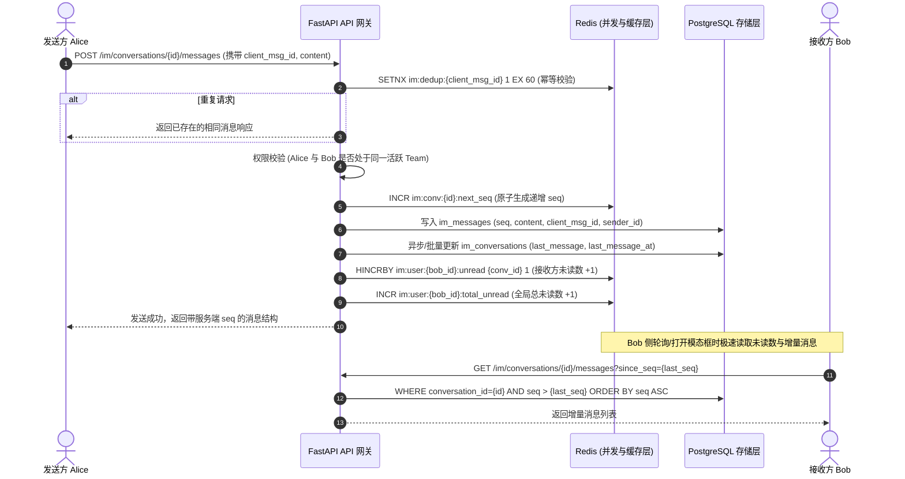

# 消息中心（IM流与高并发架构）设计文档

## Background & Goals

### 1. 问题与现状
- **现有通知中心局限**：原系统仅有单向的通知列表（`Notification`），以独立页面（`/app/notifications`）形式呈现，不支持用户之间实时交互。
- **并发能力未设计**：原通知系统主要针对单向低频写入设计，未考虑多用户并发互发消息时的行锁冲突、消息乱序、未读数写放大和深分页扫描等高并发挑战。
- **用户交互断层**：用户在协同场景中需要点对点沟通，且系统审批/告警等事件与聊天割裂。

### 2. 目标与成功指标
- **全局模态框体验**：移除独立大页面形式的通知中心，改造为全站任何页面可通过顶栏消息图标即刻弹出的轻量全局模态框（Modal Dialog），支持左侧会话列表、右侧消息流的双栏自适应布局。
- **团队内 IM 互通**：支持同一团队成员之间随时发起单聊，天然基于 `team_id` 进行租户级权限隔离，严禁跨团队未经授权发消息。
- **系统通知归一化**：原有系统广播、安全告警、工作流审批等通知统一作为置顶官方“系统通知”会话融入 IM 流中，并保留内联审批卡片操作（同意/拒绝）。
- **高并发与数据一致性保障**：
  - **单调自增序号（Sequence Numbering）**：基于 Redis 原子生成每个会话单调递增的 `seq`，彻底解决高并发网络抖动和服务器时钟偏差引起的消息乱序。
  - **发送幂等与去重**：客户端透传 `client_msg_id`，利用 Redis 原子锁防止网络超时重试导致消息重复投递。
  - **游标分页（Cursor Pagination）**：基于 `seq` 进行下行消息扫描，时间复杂度稳定在 $O(1)$，消除传统 `OFFSET/LIMIT` 带来的深分页全表扫描开销。
  - **极致未读数缓存**：Redis 缓存每用户全局未读计数与各会话未读计数，未读红点 $O(1)$ 极速读取，标记已读时原子扣减，并支持由 DB 已读游标随时全量重建。

---

## High-Level Design

### 1. 系统架构与数据流图

---

### 2. 数据模型设计 (Database Schema)

#### (1) 会话表: `im_conversations`
表示一个沟通上下文（用户单聊或系统通知流）：
- `id`: UUID (Primary Key)
- `team_id`: UUID (外键关联 teams，团队边界强隔离)
- `type`: CharEnum (`direct` 单聊, `system` 系统通知)
- `user1_id`: UUID (可为空，单聊时存放字典序较小的 user UUID)
- `user2_id`: UUID (可为空，单聊时存放字典序较大的 user UUID)
- `last_message_content`: Text (冗余最新一条消息摘要，列表直读无需 JOIN)
- `last_message_at`: Datetime (最新消息时间，用于列表排序)
- `latest_seq`: BigInt (会话内当前最大消息 seq)
- `created_at`, `updated_at`: Datetime
- **约束与索引**：
  - 联合唯一索引：`UNIQUE(team_id, type, user1_id, user2_id)` 防止高并发下两个用户同时点击聊天重复建表
  - 索引：`(team_id, updated_at DESC)`

#### (2) 会话参与者状态表: `im_conversation_participants`
维护每个用户对该会话的个性化私有状态：
- `id`: UUID (Primary Key)
- `conversation_id`: UUID (外键关联 im_conversations, CASCADE)
- `user_id`: UUID (外键关联 users, CASCADE)
- `last_read_seq`: BigInt (该用户的已读游标序号，默认为 0)
- `is_pinned`: Boolean (是否置顶，默认 false；系统通知默认 true)
- `is_muted`: Boolean (是否免打扰，默认 false)
- `created_at`, `updated_at`: Datetime
- **约束与索引**：
  - 联合唯一索引：`UNIQUE(conversation_id, user_id)`
  - 索引：`(user_id, is_pinned DESC, updated_at DESC)`

#### (3) 消息表: `im_messages`
存放会话内不可变的单条消息实体：
- `id`: UUID (Primary Key)
- `conversation_id`: UUID (外键关联 im_conversations, CASCADE)
- `sender_id`: UUID (发送者 ID，系统通知时为空)
- `client_msg_id`: String(64) (客户端生成的 UUID，用于幂等去重)
- `seq`: BigInt (会话内的单调自增序号，从 1 开始)
- `msg_type`: CharEnum (`text`, `markdown`, `card`, `system_notice`)
- `content`: Text (消息正文内容)
- `payload`: JSON (富交互结构体，如审批卡片状态、业务跳转链接等)
- `created_at`: Datetime (消息创建时间)
- **约束与索引**：
  - 联合唯一索引：`UNIQUE(conversation_id, seq)` (强一致保障严格递增无重复)
  - 索引：`INDEX(conversation_id, seq DESC)` (游标查询极速命中)
  - 索引：`INDEX(client_msg_id)` (用于快速命中幂等性查询)

---

### 3. 高并发架构关键机制

1. **分布式原子序列号生成 (`seq`)**
   - Key: `im:conv:{conv_id}:next_seq`
   - 发送前执行 `new_seq = await redis.incr(key)`。若 Key 不存在，从 DB 读取 `SELECT MAX(seq)` 初始化后再自增。
   - 写入 DB 时以 `(conversation_id, seq)` 唯一索引落库。
2. **幂等防重机制**
   - Key: `im:dedup:{client_msg_id}`
   - 使用 Redis `SET ... EX 60 NX`，若写入失败说明 60 秒内出现并发重试，直接查库返回已有消息，保护数据库不受冲击。
3. **未读数快速聚合**
   - 用户总未读数 Key: `im:user:{user_id}:total_unread` (String)
   - 用户各会话未读数 Key: `im:user:{user_id}:conv_unread` (Hash, field=conv_id)
   - 发送时 `HINCRBY`，标记已读时原子扣减。当缓存失效或出现异常时，通过对比 `im_messages.seq` 与 `im_conversation_participants.last_read_seq` 随时重建缓存。
4. **游标拉取 (Cursor-based Query)**
   - 历史消息翻页：`GET /messages?before_seq=120&limit=20` -> `WHERE conversation_id = ? AND seq < 120 ORDER BY seq DESC LIMIT 20`
   - 增量新消息拉取：`GET /messages?after_seq=100&limit=50` -> `WHERE conversation_id = ? AND seq > 100 ORDER BY seq ASC LIMIT 50`
   - 全程走 B-Tree 索引 `(conversation_id, seq)`，开销恒定。

---

## Implementation Plan

### Stage 1: 后端数据模型与并发基础设施 (Models & Redis Utilities)
- **Files modified/created**:
  - `backend/app/models/im.py` (新增会话、参与者、消息模型及枚举)
  - `backend/app/models/__init__.py` (注册新模型)
  - `backend/app/services/im_redis.py` (封装原子自增 seq、幂等防重锁、未读数缓存与重建辅助方法)
- **Specific logic**:
  - 实现 `ImConversation`, `ImConversationParticipant`, `ImMessage`。
  - 实现 `generate_next_seq(conversation_id)`, `acquire_dedup_lock(client_msg_id)`, `increment_unread(user_id, conv_id)`, `mark_read_cache(user_id, conv_id, count)`.
- **Validation**:
  - 编写单元测试验证模型定义、联合唯一约束以及 Redis 并发序列号生成与自旋初始化。

### Stage 2: IM 核心业务服务层 (IM Service)
- **Files modified/created**:
  - `backend/app/services/im_service.py`
- **Specific logic**:
  - `get_or_create_direct_conversation(team_id, user1_id, user2_id)`：严格校验两人都在同一活跃团队中，按 UUID 排序确保唯一。
  - `send_message(conversation_id, sender_id, client_msg_id, content, msg_type, payload)`：原子自增 seq，持久化消息，更新会话摘要，增加接收方未读数。
  - `list_conversations(team_id, user_id)`：获取会话列表，带对方用户信息、最后消息摘要和未读数，置顶系统通知居首。
  - `get_messages(conversation_id, user_id, before_seq, after_seq, limit)`：权限检查与游标查询。
  - `mark_as_read(conversation_id, user_id, up_to_seq)`：更新参与者已读游标并刷新缓存。
- **Validation**:
  - 编写 Service 层单元测试，测试正常发送、重复发送防重、越权跨团队检测、已读扣减逻辑。

### Stage 3: 系统通知无缝融入 IM 流 (System Notification Bridge)
- **Files modified/created**:
  - `backend/app/services/im_system_bridge.py`
  - `backend/app/services/auto_notification.py` (适配器模式桥接)
- **Specific logic**:
  - 系统为每个用户在其默认团队中确保存在一个 `type="system"` 的专用系统会话。
  - 当工作流审批（`workflow.pause_pending`）、安全警报、公告触发时，直接调用桥接服务写入该用户的系统会话，`msg_type` 设为 `card` 或 `announcement`，`payload` 携带审批 action 信息。
- **Validation**:
  - 验证原工作流暂停/审批卡片数据正确写入 IM 消息流并带有结构化 payload。

### Stage 4: API 路由与鉴权接口 (FastAPI Endpoints)
- **Files modified/created**:
  - `backend/app/api/v1/endpoints/im.py` (新增 IM 相关路由)
  - `backend/app/api/v1/api.py` (挂载 `/im` 路由)
  - `backend/app/schemas/im.py` (Pydantic 请求与响应契约)
- **Specific logic**:
  - `GET /api/v1/im/conversations`: 获取当前团队当前用户的会话列表
  - `POST /api/v1/im/conversations/direct`: 创建或唤起单聊会话
  - `GET /api/v1/im/conversations/{id}/messages`: 游标获取消息列表
  - `POST /api/v1/im/conversations/{id}/messages`: 发送消息
  - `POST /api/v1/im/conversations/{id}/read`: 标记已读
  - `GET /api/v1/im/unread-count`: 快速获取总未读数
  - `GET /api/v1/im/events`: SSE 实时长连接（基于 Redis Pub/Sub 广播新消息、多端已读同步与心跳保活）
  - 用户端下线：从 `backend/app/api/v1/api.py` 中彻底移除 `/api/v1/notifications` 用户端路由，全量切换为 `/api/v1/im`
  - 编写 API 端点集成测试，覆盖鉴权、跨团队访问拦截、参数校验与序列化。

### Stage 5: 前端全局模态框与 IM 会话流交互 (Frontend Modal & Chat Stream)
- **Files modified/created**:
  - `frontend/lib/api/im.ts` (IM 前端 API 客户端与类型定义)
  - `frontend/components/im/message-center-dialog.tsx` (消息中心模态框)
  - `frontend/components/im/conversation-list.tsx` (会话列表：系统通知置顶、团队单聊、未读 Badge)
  - `frontend/components/im/chat-window.tsx` (右侧聊天主窗口：消息流展示、气泡、内联工作流审批卡片)
  - `frontend/components/im/message-input.tsx` (文本/Markdown 输入框，支持 Enter 发送，Shift+Enter 换行)
  - `frontend/components/im/new-chat-dialog.tsx` (发起单聊联系人选择器，过滤当前团队成员)
  - `frontend/components/layout/platform-header.tsx` (顶栏图标改造：未读数轮询绑定，点击直接弹出模态框)
- **Specific logic**:
  - 模态框采用自适应 Dialog（大屏双栏，移动端自动切换层级）。
  - 支持快捷键唤起和 Esc 退出，打开会话自动触发已读标记。
- **Validation**:
  - 编写前端组件单元测试与行为测试（测试打开、切换会话、发送输入、审批卡片渲染）。

### Stage 6: 下线原独立通知中心页面与路由平滑兼容 (Cleanup & Cutover)
- **Files modified/created**:
  - `frontend/app/(platform)/app/notifications/page.tsx` (下线独立展示，改为 301 重定向到 `/app` 并自动携带触发模态框的 query/状态)
  - `frontend/i18n/zh/notifications.json` / `en/notifications.json` (文案更新为“消息中心”，补充 IM 会话、发送、联系人相关多语言词条)
  - `frontend/i18n/zh/platform.json` / `en/platform.json` (更新顶栏菜单文案为“消息中心”)
- **Specific logic**:
  - 清理废弃的旧独立表格组件，消除冗余代码。
- **Validation**:
  - 运行 `bun test` 确认旧页面测试与引用的平稳过渡。

### Stage 7: 全面测试与门禁验证 (Verification & Gates)
- **Specific logic**:
  - 运行全量后端测试：`uv run pytest backend/tests -v`
  - 运行全量前端测试：`bun test`
  - 运行类型与代码风格检查：`bun run check`
- **Validation**:
  - 确认无类型错误、无未对齐的国际化词条、无性能退化。

---

## Testing Strategy

### 1. 正向功能测试 (Happy Path)
- **团队成员建聊**：在同一团队内，用户 A 搜索同团队用户 B 并发起会话，成功建立单聊会话；双方会话列表中均能实时展示。
- **消息发送与时序**：用户 A 连续发送多条消息，服务端按原子递增的 `seq` 严格落库，用户 B 端拉取顺序完全一致。
- **系统通知会话**：触发工作流审批或系统公告，消息自动出现在置顶的“系统通知”会话中，内联审批按钮可正常交互。
- **未读标记**：用户 B 查看消息流后，已读游标前进，顶栏及会话列表未读 Badge 立即消除。

### 2. 异常与安全路径测试 (Negative & Security)
- **跨团队阻断**：用户 A 尝试通过 API 给非同一团队的用户 C 发起单聊或发消息，服务端强校验阻断并抛出 `403 FORBIDDEN` / `TeamAccessDenied`。
- **并发与幂等**：使用相同 `client_msg_id` 并发发起 10 次请求，验证 Redis 锁生效，数据库仅落库 1 条消息且均返回成功。
- **消息伪造阻断**：非会话参与者尝试拉取该会话消息或向其发送消息，拒绝访问。

### 3. 回归测试
- 工作流暂停与恢复审批逻辑正常工作。
- 登录、用户信息、模型与工作台等主业务路径无副作用。

---

## Risks & Mitigation

| 风险点 | 影响分析 | 缓解方案 |
| :--- | :--- | :--- |
| **高并发下消息乱序** | 网络延迟或分布式实例时间漂移导致 UI 展示先后错乱 | 不以客户端/服务器绝对时钟排序，严格以每个会话内 Redis 生成的自增 `seq` 排序。 |
| **Redis 缓存与 DB 瞬态不一致** | Redis 故障或重启导致未读数丢失 | 数据库中持久化存储每个参与者的 `last_read_seq`，未读数丢失时可通过一条聚合 SQL 随时全量无损重建。 |
| **旧通知数据割裂** | 历史存量系统通知在新 IM 模态框中无法查看 | 系统通知会话读取接口提供平滑兼容逻辑，按需将现有 `Notification` 映射并入系统通知消息流中。 |
